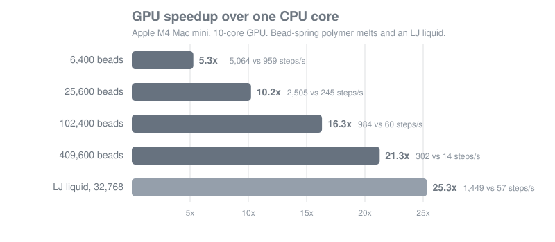

<p align="center">
  <a href="https://github.com/aldorvasq/HOOMD-metal">
    
  </a>
</p>

<p align="center">
  <strong>HOOMD-blue molecular dynamics on the GPU of your Mac.</strong>
</p>

<p align="center">
  <a href="https://github.com/aldorvasq/HOOMD-metal/releases"></a>
  
  
  <a href="https://github.com/glotzerlab/hoomd-blue"></a>
  <a href="https://doi.org/10.5281/zenodo.23457466"></a>
  <a href="#license"></a>
</p>

**HOOMD-metal** runs [HOOMD-blue](https://github.com/glotzerlab/hoomd-blue) simulations on the
GPU of Apple silicon Macs (M1, M2, M3, M4, M5 and their Pro, Max, and Ultra variants). It adds a
Metal GPU backend to HOOMD-blue, so the scripts you already have run on your Mac's GPU without
changes: `hoomd.device.GPU()` selects it.

> HOOMD-metal is an independent, community project. It is not developed, endorsed, or supported
> by the HOOMD-blue team at the University of Michigan. Please report problems with HOOMD-metal
> [here](https://github.com/aldorvasq/HOOMD-metal/issues), not to the HOOMD-blue developers.

## Highlights

- **Your scripts work as they are.** Same `import hoomd`, same API, same GSD files.
- **Every molecular dynamics feature on the GPU:** pair, bond, angle, dihedral, and many-body
  potentials, PPPM electrostatics, rigid bodies, constraints, all integrators and thermostats,
  and the MPCD solvent.
- **5-25x faster than a CPU core** on an M4 Mac mini, more on bigger Macs (see
  [Performance](#performance)).
- **Checked against the CPU.** A validation suite compares GPU and CPU results on your own Mac
  in about two minutes.
- **One-command install** into a conda environment.

## Quick start

You need an Apple silicon Mac with macOS 15 (Sequoia) or newer, Apple's command line tools
(`xcode-select --install`), and an arm64 conda such as
[Miniforge](https://github.com/conda-forge/miniforge).

```bash
git clone --recursive https://github.com/aldorvasq/HOOMD-metal.git
cd HOOMD-metal
metal/install.sh --validate      # build (~5 min), install, and check the GPU against the CPU
conda activate hoomd-metal
python metal/examples/polymer_melt.py
```

The installer creates the conda environment `hoomd-metal`. To update later, `git pull` and run
`metal/install.sh` again. More options are in the [technical guide](metal/README.md).

## Using your existing HOOMD-blue scripts

HOOMD-metal is HOOMD-blue 7.2 with a new GPU backend, so a script written for HOOMD-blue runs
unchanged. The only line that decides where it runs is the device:

```python
import hoomd

device = hoomd.device.GPU()          # the Mac's GPU (hoomd.device.auto_select() also picks it)
sim = hoomd.Simulation(device=device, seed=1)
# ... the rest of your script, exactly as before
```

What stays the same and what is different:

| | |
|---|---|
| **Same** | The Python API and documentation of [HOOMD-blue 7.2](https://hoomd-blue.readthedocs.io/). GSD trajectories, readable by OVITO, VMD, freud, and `gsd`. Random numbers: with the same seed, CPU and GPU runs draw the same random numbers. |
| **Precision** | Single precision (32-bit floats) only, because Apple GPUs have no double precision arithmetic. This is ample for typical soft matter MD, but results match a single precision build of HOOMD-blue, not the double precision conda-forge build. `hoomd.version.floating_point_precision` reports `(32, 32)`. |
| **Not included** | Hard particle Monte Carlo (`hoomd.hpmc`), which HOOMD-blue only supports in double precision. MPI: a Mac has one GPU, and one HOOMD-metal process already uses all of it. |
| **First run** | Each GPU kernel is compiled for your Mac the first time it is used, which adds a second or two at the start of a script. |
| **Installation** | HOOMD-metal replaces the `hoomd` package in its own conda environment. Keep conda-forge's `hoomd` in a separate environment if you also need double precision or HPMC. Plugins compiled for upstream HOOMD-blue must be rebuilt against HOOMD-metal. |

## Example

[`metal/examples/polymer_melt.py`](metal/examples/polymer_melt.py) is a plain HOOMD-blue script: a
Kremer-Grest bead-spring melt (WCA + FENE) with Langevin dynamics that writes a GSD trajectory.
On an M4 Mac mini:

```console
$ python metal/examples/polymer_melt.py                 # 25,000 beads on the GPU
25000 beads, 10000 steps in 4.0 s: 2501 steps/s

$ python metal/examples/polymer_melt.py --device cpu    # the same simulation on one CPU core
25000 beads, 2000 steps in 7.7 s: 261 steps/s
```

## Performance

<p align="center">
  
</p>

The GPU gains most on large systems. Measure your own Mac with
`python metal/bench/benchmark.py` (add `--device cpu` for the CPU numbers).

| Mac | What to expect |
|---|---|
| MacBook Air, Mac mini, iMac (M1-M5) | The numbers above, scaled by memory bandwidth (68-153 GB/s; the M4 has 120). Fanless MacBook Airs slow down during long runs but give the same results. |
| M Pro and M Max | Up to about 1.3-4.5x faster than an M4 on large systems (150-546 GB/s). |
| M Ultra (Mac Studio) | Up to about 6x faster than an M4 on large systems (800-819 GB/s). The Ultra appears as one GPU, and HOOMD-metal uses all of it. |

Systems below about 10,000 particles are limited by a fixed cost per time step, so they gain
little from a bigger GPU; run several simulations at once instead. A bead-spring melt needs about
1.2 KB of memory per bead, so even an 8 GB Mac holds about 3 million beads.

## Validation

```bash
python metal/validate/validate.py            # 10 checks, about 2 minutes
python metal/validate/validate.py --pytest   # also HOOMD-blue's own test suite on both devices
```

Every check runs the same simulation on the CPU and on the GPU of your Mac and compares them:
forces, energies, and virials for all potentials; neighbor lists; PPPM; rigid bodies; RATTLE
constraints; MPCD; and bead-spring melts with NVE, Langevin, NPT, and Bussi dynamics. On an M4
Mac mini all 404 comparisons pass, and HOOMD-blue's test suite shows no GPU-only failures beyond
14 explained single precision cases. The
[technical guide](metal/README.md#check-this-mac) lists the checks and their tolerances.

## Citing

If you use HOOMD-metal in published work, please cite HOOMD-blue:

> J. A. Anderson, J. Glaser, and S. C. Glotzer. HOOMD-blue: A Python package for
> high-performance molecular dynamics and hard particle Monte Carlo simulations.
> *Computational Materials Science* 173: 109363, Feb 2020.
> [10.1016/j.commatsci.2019.109363](https://doi.org/10.1016/j.commatsci.2019.109363)

and HOOMD-metal itself:

> A. Vásquez-Briceño. HOOMD-metal: HOOMD-blue molecular dynamics on Apple silicon GPUs. Zenodo.
> [10.5281/zenodo.23457466](https://doi.org/10.5281/zenodo.23457466)

This DOI always points to the latest release; each release also has its own DOI on
[Zenodo](https://doi.org/10.5281/zenodo.23457466). GitHub's "Cite this repository" button gives
the same reference in other formats.

## Documentation and help

- [HOOMD-blue documentation](https://hoomd-blue.readthedocs.io/): tutorials and the full Python
  API, which HOOMD-metal shares.
- [Technical guide](metal/README.md): installer options, validation details, runtime settings,
  and how the Metal backend works.
- [Issues](https://github.com/aldorvasq/HOOMD-metal/issues): questions and bug reports about
  HOOMD-metal.

## License

HOOMD-metal combines two licenses. HOOMD-blue's code, including the Metal versions of its GPU
kernels and every change to its files, remains under HOOMD-blue's
[BSD 3-Clause License](LICENSE). The new HOOMD-metal code (the Metal runtime in `hoomd/mtl`, the
tools in `metal/`, and `CMake/hoomd/HOOMDMetalSetup.cmake`) is released under the
[MIT License](LICENSE-MIT). Each file's header states which license applies.

## Acknowledgments

HOOMD-metal is built entirely on [HOOMD-blue](https://glotzerlab.engin.umich.edu/hoomd-blue/),
developed by the [Glotzer Group](https://glotzerlab.engin.umich.edu/) at the University of
Michigan and its contributors. The HOOMD-metal logo is the HOOMD-blue logo in silver, with the
letter t from the [hoomd-rs](https://github.com/glotzerlab/hoomd-rs) logo.
